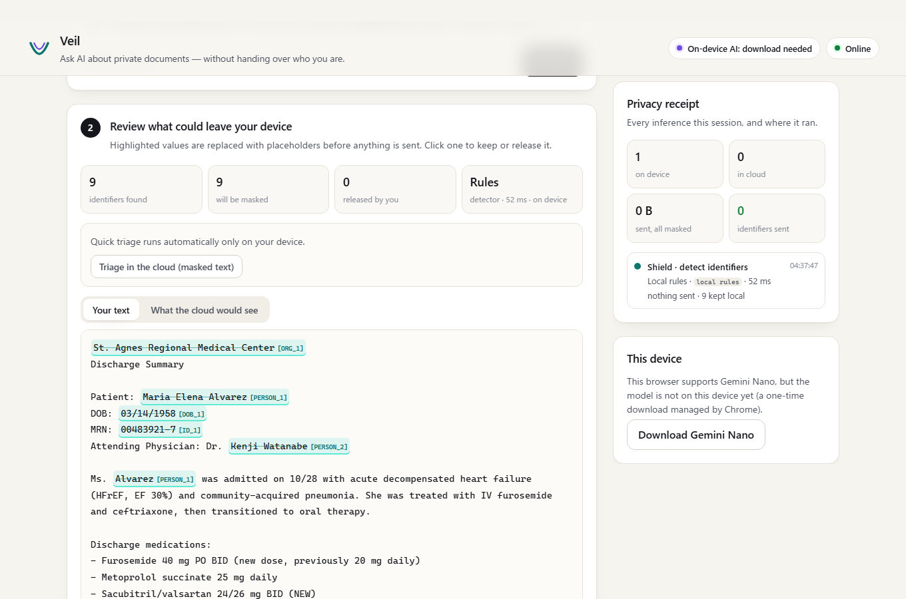
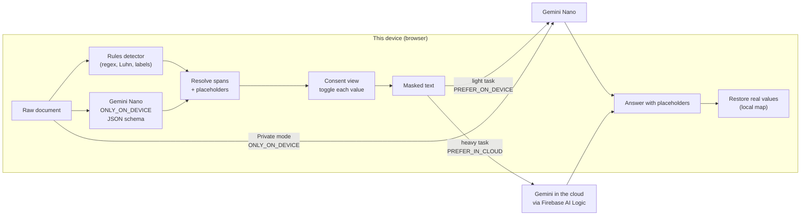

# Veil — ask AI about your private documents without handing over who you are

**Live demo:** https://class-now.github.io/buildhybridai-2026/  ·  Built for **#BuildHybridAI 2026** with **Firebase AI Logic hybrid inference** (Gemini Nano in Chrome + Gemini in the cloud).

People get confusing, high-stakes documents every week: a hospital discharge note for an elderly parent, a "pay rent or quit" notice, an insurance claim denial. Asking an AI to explain them is the obvious move, but those documents are full of exactly what you should never paste into a chatbot: names, dates of birth, medical record numbers, addresses, policy and card numbers.

Veil splits the job between the device and the cloud:

1. **Detect on the device.** Deterministic rules plus **Gemini Nano** (`ONLY_ON_DEVICE`, structured JSON output) find the identifiers in the text.
2. **Mask on the device.** Each value becomes a stable placeholder (`[PERSON_1]`, `[ID_1]`, `[ADDRESS_2]`...). The mapping lives only in page memory.
3. **Route.** Light tasks (summary, checklist, short questions) use `PREFER_ON_DEVICE`. Heavy tasks (jargon glossary, drafting a reply) use `PREFER_IN_CLOUD`. *Private* mode uses `ONLY_ON_DEVICE` and *Cloud* mode uses `ONLY_IN_CLOUD`. Every answer shows where it actually ran (`response.inferenceSource`).
4. **Restore on the device.** Placeholders in the answer are swapped back for the real values on your screen, so the reply reads naturally ("call Dr. Watanabe's clinic") even though the cloud only ever saw `[PERSON_2]`.

A **privacy receipt** lists every inference in the session: mode, where it ran, latency, bytes that left the device, and how many identifiers were withheld or released.



## Why this idea

- **Hybrid inference is the product, not a fallback.** Most hybrid apps use the cloud only when the device can't run the model. Veil uses the device for the part the cloud must never see (finding identifiers in raw text) and the cloud for the part the device does poorly (long, careful explanations and drafting), with a privacy boundary in between.
- **One invariant makes the fallback safe:** *raw text is only ever passed to a model created with `ONLY_ON_DEVICE`.* Anything sent with `PREFER_ON_DEVICE` or `PREFER_IN_CLOUD` is masked first, so it doesn't matter which way Firebase AI Logic routes it.
- **Real users, real stakes.** Caregivers reading discharge instructions, tenants facing a 3-day notice, patients fighting a denied claim. These users need cloud-quality explanations and have the most to lose from oversharing.
- **It degrades gracefully.** No Gemini Nano? The rule-based shield still runs locally and the cloud gets masked text. Offline with Nano? Private mode and light tasks keep working, and cloud-preferred tasks fall back to the device. Offline without Nano? The shield still works and the UI says exactly why generation can't run.

## How it works



| Step | Firebase AI Logic mode | Input | Why |
|---|---|---|---|
| Identifier detection | `ONLY_ON_DEVICE` + `responseConstraint` (JSON) | raw text | must never leave the device; falls back to rules only |
| Triage (category, urgency, deadline) | `PREFER_ON_DEVICE` + JSON schema on both sides | masked | runs automatically only when Nano is ready; the cloud version needs a click |
| Summarize / checklist / question | `PREFER_ON_DEVICE` | masked | fast, free, works offline; cloud fallback is safe because the input is masked |
| Explain jargon / draft reply | `PREFER_IN_CLOUD` | masked | better quality; falls back to Nano when the network fails |
| Long documents (over ~20k chars) | `PREFER_IN_CLOUD` | masked | beyond the on-device context window |
| Private mode | `ONLY_ON_DEVICE` | raw | nothing leaves the device |
| Cloud mode | `ONLY_IN_CLOUD` | masked | best quality on demand |

Implementation notes:

- `onDeviceParams.createOptions` asks only for English text input and output. The SDK default also requests image input, which needs an extra Chrome flag and makes `availability()` report `unavailable` on many machines.
- Model download is started from a user gesture with `initializeDeviceModel()`, with a progress bar. Until it finishes, `PREFER_*` requests use the cloud with masked text.
- Gemini Nano's detections are accepted only if the exact string appears in the document, so a hallucinated "identifier" can't change the text.
- Surnames of detected people are masked everywhere ("Ms. Alvarez" shares `[PERSON_1]` with "Maria Elena Alvarez").
- A small service worker keeps the app shell available offline. Model calls are never cached.

Code map: `src/ai.ts` (capability check, model factory, streaming, errors) · `src/router.ts` (tasks and the routing policy) · `src/shield/` (rules, Nano detector, masking and restore) · `src/main.ts` (UI).

## Built during the submission period (from Nov 11, 2026 PT)

Veil's first version (shield, mask, hybrid routing, privacy receipt) went live on Nov 10. Work done in the submission period:

- **Scan a paper letter (Nov 13).** Take or upload a photo of a letter; Gemini Nano's image input reads it on the device and fills the document box. The image model is created with `ONLY_ON_DEVICE` and no cloud parameters, so a photo can never fall back to the cloud: on a device without image input Veil says so and sends nothing. Tall pages are cut into overlapping bands to keep small print legible, and the band texts are joined without duplicated lines. "Try a scanned letter" renders a sample letter as a photo in the browser so the feature can be tried without a camera.
- **Case folders (Nov 14).** Real problems come in several letters: the discharge note, the hospital bill, the insurer's explanation of benefits. A case folder keeps related documents together in this browser (localStorage, never uploaded). "Open the whole case" shields every document together, so one person gets one placeholder across all of them — even when the insurer writes "Maria E. Alvarez" and the hospital writes "Maria Elena Alvarez" — and values you chose to release stay released for that case. A new task, **Connect the case**, builds one timeline across the documents with "Document k" citations and lists what does not add up (in the sample: the bill asks for the ambulance charge the insurer denied for missing paperwork). Try it with the "Case folder" sample button.
- **Tests run in real Chrome.** reCAPTCHA Enterprise (App Check) rejects the bundled headless Chromium, so the end-to-end check now uses the installed Chrome. 19/19 checks pass on the public URL, including two new ones for Scan (reads on device; no request reaches Google while scanning, with or without Nano).

## Run it locally

```bash
npm install
npm run dev        # http://localhost:5173/buildhybridai-2026/
npm run build && npx vite preview --port 4173
node scripts/e2e.mjs http://localhost:4173/buildhybridai-2026/   # headless checks
```

To use Gemini Nano: desktop Chrome 139+, enable `chrome://flags/#prompt-api-for-gemini-nano-multimodal-input` (and `#prompt-api-for-gemini-nano` if listed), restart, then press **Download Gemini Nano** in the app.

### Using your own Firebase project

1. Create a Firebase project, add a Web app, and enable **Firebase AI Logic** with the Gemini Developer API.
2. Replace the config in `src/firebase.ts`.
3. App Check (recommended; Firebase AI Logic may enforce it): register the web app with reCAPTCHA v3 or Enterprise in **App Check**, then build with `VITE_RECAPTCHA_SITE_KEY=<site key>` (add `VITE_RECAPTCHA_ENTERPRISE=1` for Enterprise). For local development, also set `VITE_APPCHECK_DEBUG_TOKEN` to a debug token registered in the console. On GitHub Pages, set these as repository **variables**; `.github/workflows/pages.yml` passes them to the build.

## Tests

`scripts/e2e.mjs` drives the built app in headless Chromium:

- **Cloud path (no Nano):** shields the sample, calls Gemini, and checks that **no raw identifier appears in any request body sent to Google**.
- **Device path:** stubs Chrome's Prompt API (`LanguageModel`) and checks that `PREFER_ON_DEVICE` requests report `inferenceSource === "on_device"` and that **zero requests reach Google**.
- **Offline:** without Nano, runs are blocked with an explanation. With Nano, Private mode runs `ONLY_ON_DEVICE`.

## Limitations

- Detection is best effort. Veil shows every detection and the exact outbound text before anything is sent, and you can mask or release any value.
- Gemini Nano is configured for English. Other languages fall back to the rules plus the masked cloud path.
- Not medical, legal or financial advice.

## License

MIT
